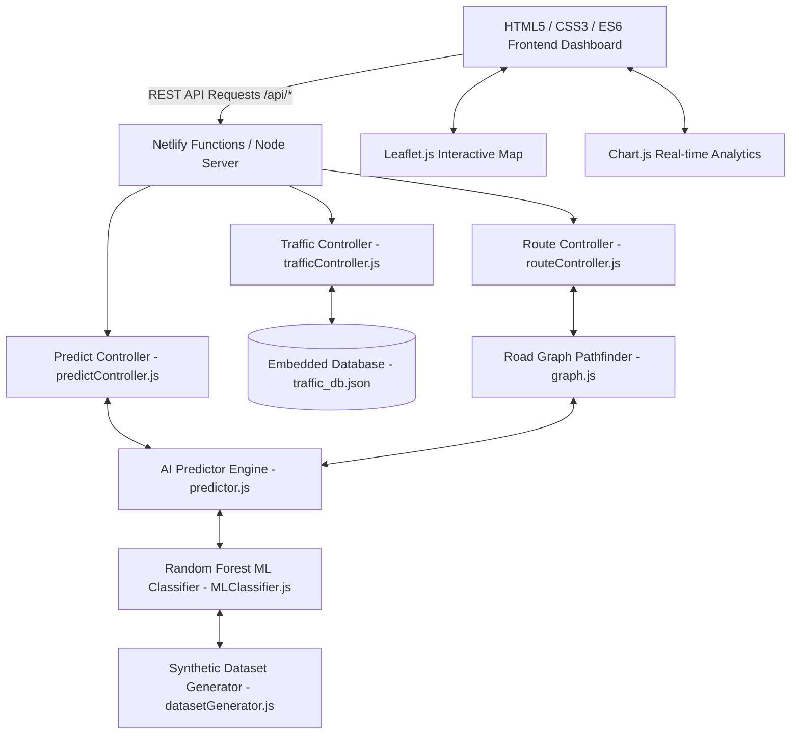

# AI-Powered Smart Traffic Monitoring and Accident Prediction System

An intelligent urban mobility and predictive traffic management platform designed for monitoring traffic telemetry, predicting congestion and accident risks using Machine Learning, calculating optimal emergency/commute routes via Dijkstra pathfinding, and visualizing live analytics through an interactive web dashboard.

---

## 🌟 Key Features

1. **Real-time Traffic Monitoring**:
   - Live telemetry feed displaying traffic density (%), average vehicle speed (km/h), road capacity, and Level of Service (LOS).
   - Automated simulation engine for continuous traffic fluctuations.
2. **AI/ML Accident Risk Prediction Engine**:
   - Random Forest & Decision Tree Classifier evaluating 6 key risk factors: Traffic Density, Speed Variance, Weather Condition, Road Surface Condition, Time of Day, and Historical Accident Count.
   - Categorizes risk as **Low**, **Medium**, or **High** with exact probability confidence scores.
   - Identifies contributing risk factors (e.g. Hydroplaning risk, Dense Fog, Unsafe Speed).
3. **Traffic Congestion Prediction**:
   - Computes dynamic Congestion Index (0–100%) and categorizes flow as *Smooth*, *Moderate*, *Heavy*, or *Severe*.
   - Provides 15-minute, 30-minute, and 60-minute lookahead forecast projections.
4. **Interactive Leaflet.js Map Integration**:
   - Color-coded road polylines (Green: Smooth, Yellow: Moderate, Red: Heavy, Dark Red: High Risk).
   - Clickable intersection nodes and accident marker overlays with live telemetry popups.
   - Support for custom Mapbox or Google Maps tile servers via environment variables.
5. **Dijkstra Route Optimizer**:
   - Pathfinding algorithm operating on city road graph network.
   - Calculates primary (fastest & safest) and alternative routes weighted by travel time, congestion delay, and AI accident risk penalties.
6. **AI Model Evaluation Metrics**:
   - Evaluates Validation Accuracy, Precision, Recall, Macro F1 Score, Confusion Matrix, and Feature Importance weightings.
7. **Embedded Database**:
   - Thread-safe JSON database (`data/traffic_db.json`) storing roads, intersections, accident logs, and event histories with full REST CRUD operations.
8. **Netlify Production Ready**:
   - Dual execution support: local standalone Node.js server or Netlify Serverless Functions (`functions/api.js`) for zero-cost cloud production hosting.

---

## 🏗️ System Architecture



---

## 📁 Directory Structure

```
AI Traffic Monitoring Project/
├── netlify.toml                # Netlify build settings, publish directory, & proxy redirects
├── functions/
│   └── api.js                  # Netlify Serverless Function entrypoint for REST API & ML
├── config/
│   └── default.json             # Default thresholds, weather weights, and system parameters
├── data/
│   ├── traffic_db.json          # Persistent database (roads, intersections, accidents, events)
│   └── sample_dataset.json      # Generated synthetic dataset (1,200 training records)
├── src/
│   ├── backend/
│   │   ├── server.js            # Standalone local development REST API server
│   │   ├── db.js                # Database manager (CRUD & seed handler with serverless fallbacks)
│   │   ├── graph.js             # Road network graph & Dijkstra pathfinding engine
│   │   └── controllers/
│   │       ├── trafficController.js  # Telemetry endpoints
│   │       ├── predictController.js  # ML prediction endpoints
│   │       └── routeController.js    # Route optimization endpoints
│   ├── ml/
│   │   ├── datasetGenerator.js  # Synthetic traffic dataset synthesizer
│   │   ├── MLClassifier.js      # Random Forest & Decision Tree ML classifier
│   │   └── predictor.js         # ML predictor, metrics evaluator, & feature weightings
│   └── frontend/
│       ├── index.html           # Main responsive web dashboard layout
│       ├── css/
│       │   └── styles.css       # Dark slate CSS design system & responsive layout
│       └── js/
│           ├── app.js           # Main application state binder
│           ├── mapManager.js    # Leaflet map overlays & route polyline renderer
│           ├── charts.js        # Chart.js analytics visualizer
│           ├── simulator.js     # Live telemetry simulator & controls
│           └── apiService.js    # REST API client bridge
├── tests/
│   ├── test_ml_and_routes.js    # Automated unit & verification test suite
│   └── test_netlify_function.js # Automated Netlify serverless function test suite
├── .env.example                 # Environment variables template
├── package.json                 # Project configuration & scripts
└── README.md                    # Project documentation & presentation guide
```

---

## 🚀 Local Development

1. **Start Local Server**:
   ```bash
   node src/backend/server.js
   ```
2. **Access Dashboard**:
   Open [http://localhost:3000](http://localhost:3000).
3. **Run Automated Tests**:
   ```bash
   node tests/test_ml_and_routes.js
   node tests/test_netlify_function.js
   ```

---

## 🌐 Deploying to Netlify via GitHub

Follow these exact steps to deploy your project to Netlify:

### Step 1: Push Code to GitHub
1. Open terminal in the project directory:
   ```bash
   git init
   git add .
   git commit -m "Prepare AI Traffic Monitoring System for Netlify production deployment"
   ```
2. Create a new repository on [GitHub](https://github.com/new).
3. Link and push your repository:
   ```bash
   git remote add origin https://github.com/<YOUR-USERNAME>/<YOUR-REPO-NAME>.git
   git branch -M main
   git push -u origin main
   ```

### Step 2: Deploy on Netlify
1. Log into your [Netlify Account](https://app.netlify.com).
2. Click **"Add new site"** -> **"Import an existing project"**.
3. Select **GitHub** as your Git provider and authorize Netlify.
4. Select your **AI Traffic Monitoring** repository.
5. Netlify will automatically detect `netlify.toml` with settings:
   - **Build command**: `npm run build`
   - **Publish directory**: `src/frontend`
   - **Functions directory**: `functions`
6. *(Optional)* Add Environment Variables under **Site configuration > Environment variables**:
   - `MAPBOX_API_KEY`: *(Your optional Mapbox API Key)*
   - `GOOGLE_MAPS_API_KEY`: *(Your optional Google Maps Key)*
7. Click **"Deploy site"**.

Netlify will build your static frontend assets and launch your serverless backend REST API (`/api/*`) on Netlify Functions!

---

## 🔌 REST API Reference

| Method | Endpoint | Description |
| :--- | :--- | :--- |
| `GET` | `/api/traffic/overview` | Fetch live traffic telemetry, active accidents, and system metrics |
| `POST` | `/api/traffic/update` | Update road telemetry (density, speed, weather) |
| `POST` | `/api/traffic/weather` | Update global weather condition across all roads |
| `POST` | `/api/traffic/accident` | Report a new accident event |
| `POST` | `/api/predict/accident` | Execute ML accident risk evaluation for custom input |
| `POST` | `/api/predict/congestion` | Predict congestion index & 15/30/60-min forecasts |
| `GET` | `/api/predict/all-roads` | Fetch AI evaluations for all monitored road segments |
| `GET` | `/api/ml/metrics` | Retrieve ML validation accuracy, F1 score, confusion matrix |
| `POST` | `/api/routes/optimize` | Compute Dijkstra optimal & alternative routes |
